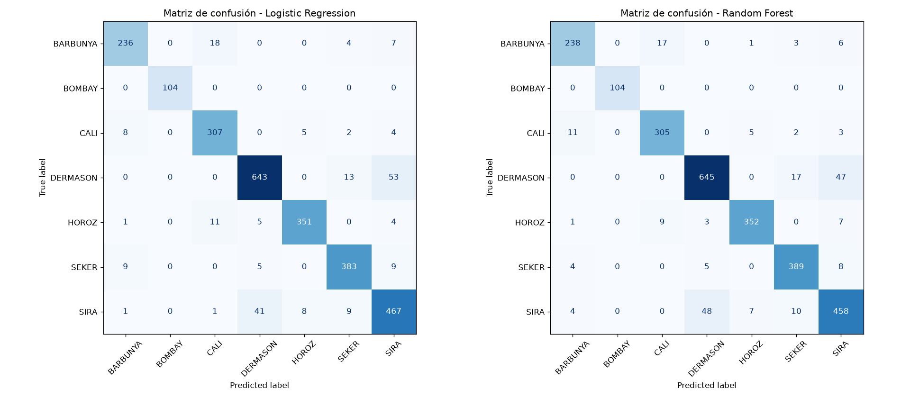

# Laboratorio de ML con datos reales — Dry Bean Dataset

**Clasificación de variedades de frijol seco aplicando CRISP-DM + TDSP + Scrum ML**

Universidad Autónoma de Occidente (UAO) · Gestión de Proyectos de IA

**Equipo:** Osvaldo Emilio Marin · Nilson Jacobo Gonzales · Edgar Adrián Ortiz - Juan Andrés Ruiz

Dataset: [Dry Bean Dataset — UCI Machine Learning Repository (id 602)](https://archive.ics.uci.edu/dataset/602/dry+bean+dataset) · 13.611 granos · 16 variables geométricas · 7 variedades.

---

## Problema de negocio

Una empresa agrícola quiere automatizar la clasificación de granos de frijol para mejorar su control de calidad. El modelo predice la variedad (`Class`: BARBUNYA, BOMBAY, CALI, DERMASON, HOROZ, SEKER, SIRA) a partir de características de forma y tamaño extraídas de imágenes.

## Resultados

| Modelo | Accuracy (test) | F1 macro (test) | F1 macro (CV 5 folds) |
|---|---|---|---|
| Logistic Regression (baseline) | 0,9195 | 0,9306 | **0,936 ± 0,007** |
| Random Forest (200 árboles, balanced) | 0,9195 | **0,9310** | 0,934 ± 0,004 |
| Random Forest + GridSearchCV | — | 0,9269 | 0,935 (CV 3) |

**Decisión:** los dos modelos están técnicamente empatados. Según el criterio del laboratorio (*preferir el modelo más simple si el desempeño es parecido*), se **recomienda la regresión logística** para despliegue. Ambos modelos quedan guardados.

**Hallazgo principal:** los errores se concentran en variedades geométricamente casi idénticas — **SIRA ↔ DERMASON** (44 % de los errores) y **BARBUNYA ↔ CALI**. BOMBAY se clasifica al 100 %. El techo de ≈93 % viene de los datos, no del modelo: mejorar requiere variables nuevas (color, textura).

<p align="center">
  
</p>

Reporte completo: [`docs/reporte_final.md`](docs/reporte_final.md)

## Estructura del proyecto (TDSP)

```
gestion-ia-laboratorio/
├── data/
│   ├── raw/                  # Datos originales sin modificar (Dry_Bean_Dataset.xlsx + descripción)
│   └── processed/            # Datos limpios (se generan al ejecutar)
├── notebooks/
│   └── 01_laboratorio_drybean.ipynb   # Notebook ejecutado: pasos 1–18 + extensiones + respuestas
├── outputs/
│   ├── models/               # Modelos entrenados (.joblib)
│   └── reports/              # Métricas (CSV/JSON), predicciones y figuras
├── src/
│   ├── config.py             # Rutas, semilla y constantes
│   ├── data.py               # Carga (UCI con respaldo local), calidad, limpieza, partición
│   ├── models.py             # Definición de baseline y Random Forest
│   ├── evaluate.py           # Métricas, matrices de confusión, errores frecuentes
│   ├── predict.py            # predict_bean_class() + CLI de predicción
│   └── laboratorio_drybean.py# Pipeline completo de extremo a extremo
├── tests/                    # Pruebas pytest (Definition of Done)
├── docs/
│   ├── reporte_final.md      # Entregable 2: reporte CRISP-DM
│   └── scrum/                # Entregable 3: backlog, tablero, sprints, retrospectiva, DoD
├── requirements.txt
└── README.md
```

## Cómo reproducirlo

```bash
git clone https://github.com/jg-uao/gestion-ia-laboratorio.git
cd gestion-ia-laboratorio

python -m venv .venv
# Linux/Mac:           source .venv/bin/activate
# Windows PowerShell:  .venv\Scripts\Activate.ps1
pip install -r requirements.txt
```

| Acción | Comando |
|---|---|
| Pipeline completo (datos → modelos → reportes) | `python -m src.laboratorio_drybean` |
| Pipeline + validación cruzada y GridSearchCV | `python -m src.laboratorio_drybean --extras` |
| Abrir el notebook | `jupyter notebook notebooks/01_laboratorio_drybean.ipynb` |
| Predecir con el modelo guardado | `python -m src.predict --input data/processed/dry_bean_clean.csv --n 5` |
| Ejecutar las pruebas | `pytest -q` |

Sin conexión a internet, la carga usa automáticamente la copia local `data/raw/Dry_Bean_Dataset.xlsx`. Todo usa `random_state=42`, por lo que los resultados son idénticos en cada ejecución.

## Metodologías

### CRISP-DM

| Fase | Dónde |
|---|---|
| 1. Comprensión del negocio | Notebook (inicio), reporte §1 |
| 2. Comprensión de los datos | Pasos 3–6: forma, tipos, outliers, nulos, duplicados, balance de clases |
| 3. Preparación | Pasos 5, 7, 8: eliminación de 68 duplicados, partición 80/20 estratificada, escalado en `Pipeline` |
| 4. Modelado | Pasos 9 y 11: Logistic Regression y Random Forest |
| 5. Evaluación | Pasos 10, 12–15 + validación cruzada y GridSearch |
| 6. Despliegue | Pasos 16–18: `joblib`, `predict_bean_class`, CLI |

### TDSP

Estructura estándar de carpetas, código modular y reutilizable en `src/`, semilla documentada, datos crudos inmutables, artefactos (modelos, métricas, figuras) versionados, pruebas automáticas.

### Scrum ML

| Rol | Integrante | Responsabilidades |
|---|---|---|
| Product Owner | Edgar Adrian Ortiz | Define objetivos, prioriza el backlog, valida la entrega final |
| Scrum Master | Osvaldo Emilio Marin | Coordina reuniones, mantiene el tablero, README y flujo Git |
| Data Engineer / Analyst | Nilson Jacobo Gonzales | Descarga, calidad, limpieza y EDA |
| ML Engineer | Edgar Adrian Ortiz | Entrenamiento, evaluación y despliegue del modelo |

Equipo de 3 integrantes: el Scrum Master asume también el rol de ML Engineer.

- Sprint 1 — Comprensión y preparación · Sprint 2 — Modelado y evaluación · Sprint 3 — Despliegue y documentación
- [Product backlog](docs/scrum/product_backlog.md) · [Tablero](docs/scrum/tablero.md) · [Sprints y daily](docs/scrum/sprints.md) · [Retrospectiva](docs/scrum/retrospectiva.md) · [Definition of Done](docs/scrum/definition_of_done.md)

### Flujo de trabajo en GitHub

1. Una rama por historia: `git checkout -b feature/<historia>`
2. Commits con el ID del backlog: `git commit -m "PB-03: baseline logistic regression"`
3. `git push origin feature/<historia>` → Pull Request → revisión de un compañero → merge a `main`
4. Antes de empezar: `git pull origin main`

## Referencia

Koklu, M. & Ozkan, I. A. (2020). *Multiclass classification of dry beans using computer vision and machine learning techniques.* Computers and Electronics in Agriculture, 174, 105507. Dataset: UCI Machine Learning Repository, Dry Bean Dataset (id 602).
