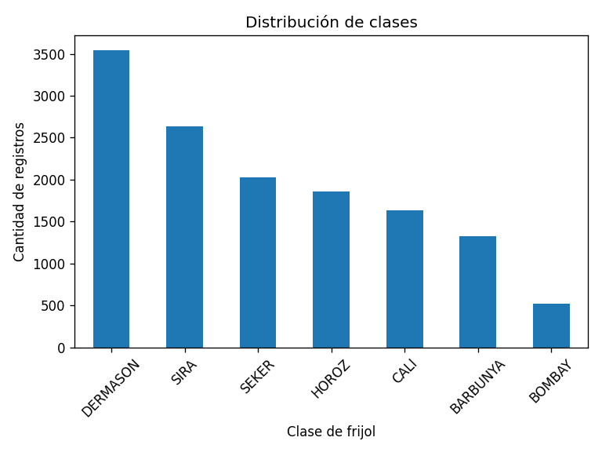
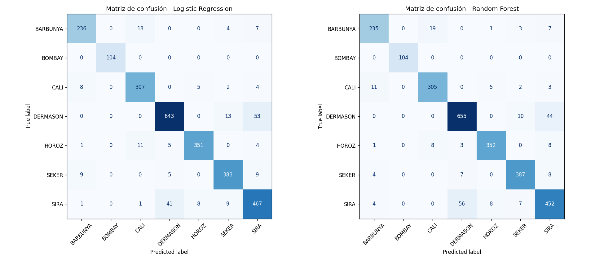
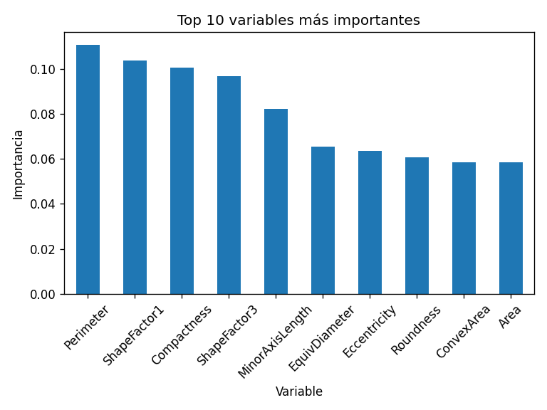

# Reporte final — Clasificación de variedades de frijol seco

**Laboratorio:** CRISP-DM + TDSP + Scrum ML con el Dry Bean Dataset (UCI, id 602)
**Curso:** Gestión de Proyectos de IA — Universidad Autónoma de Occidente

**Responsables según la distribución de entregables:** Edgar Adrian Ortiz, Product Owner (apartados 1–3 y 7); Juan Andrés Ruiz Muñoz, ML Engineer (apartados 4–6). El notebook corresponde a Nilson Jacobo Gonzales y la evidencia Scrum a Osvaldo Emilio Marin. Estas asignaciones no prueban autoría de cada cambio ni aceptación de la entrega.

**Estado comunicado por el equipo:** entrega del reporte **parcial**. Este archivo contiene los siete apartados; queda pendiente confirmar su revisión y presentación académica.

---

## 1. Comprensión del negocio

Una empresa agrícola clasifica parte de sus granos de frijol manualmente, lo que es lento y poco consistente. El objetivo es **automatizar la identificación de la variedad** a partir de 16 características geométricas extraídas de imágenes, para mejorar el control de calidad.

- **Tipo de problema:** clasificación supervisada multiclase (7 variedades).
- **Métrica de éxito:** F1 macro (todas las variedades pesan igual), complementada con accuracy y errores por clase.
- **Regla de decisión:** si dos modelos rinden parecido, se prefiere el más simple.

El negocio es el escenario simulado del laboratorio. F1 macro es un criterio técnico: todavía no se han medido ahorro de tiempo, costos de errores o beneficio en una planta real.

## 2. Comprensión de los datos

| Aspecto | Resultado |
|---|---|
| Registros | 13.611 |
| Variables | 16 predictoras numéricas (14 `float64`, 2 `int64`) + `Class` |
| Valores nulos | 0 |
| Filas duplicadas | 68 |
| Clases | DERMASON 3.546 · SIRA 2.636 · SEKER 2.027 · HOROZ 1.928 · CALI 1.630 · BARBUNYA 1.322 · BOMBAY 522 |
| Desbalance | ≈7:1 entre la clase mayor y la menor |

- Las escalas difieren mucho (`Area` ~10⁴–10⁵ vs `ShapeFactor1` ~10⁻³) → se estandariza para el modelo lineal.
- Los valores extremos son **legítimos**: de los 551 extremos de `Area`, 522 son BOMBAY (grano más grande); de los 843 de `Eccentricity`, 828 son SEKER (grano más redondo). No se eliminan.
- El `.xlsx` original trae dos columnas con nombre distinto a la versión de UCI (`AspectRation`, `roundness`); se normalizan en `src/data.py`.



## 3. Preparación de los datos

1. Eliminación de 68 duplicados exactos → **13.543 filas** (`data/processed/dry_bean_clean.csv`).
2. Separación `X` / `y` (`Class`).
3. Partición **80/20 estratificada** con `random_state=42` → 10.834 train / 2.709 test.
4. Estandarización con `StandardScaler` **dentro de un `Pipeline`**, ajustada solo con train (sin fuga de información).

## 4. Modelado

| Modelo | Configuración | Rol |
|---|---|---|
| Logistic Regression | `StandardScaler` + `LogisticRegression(max_iter=1000)` | Baseline |
| Random Forest | 200 árboles, `class_weight="balanced"` | Modelo "mejorado" |
| Random Forest + GridSearchCV | `n_estimators`, `max_depth`, `min_samples_split` (27 combinaciones, CV 3) | Extensión B |

## 5. Evaluación

### Conjunto de prueba (2.709 granos)

| Modelo | Accuracy | F1 macro |
|---|---|---|
| Logistic Regression | **0,9195** | **0,9306** |
| Random Forest | 0,9192 | 0,9303 |
| RF optimizado (GridSearch) | 0,9181 | 0,9299 |

### Validación cruzada estratificada (5 folds, F1 macro)

La extensión histórica calcula esta CV sobre las 13.543 filas limpias, incluidas las filas de la partición test. Describe variabilidad entre folds, pero no es una validación independiente del test anterior ni demuestra equivalencia estadística. Para nuevos ajustes o selección se debe hacer CV solo sobre train y reservar un test sin usar en decisiones; si este test ya se utilizó para decidir, la evaluación final requiere datos nuevos.

| Modelo | Media | Desv. estándar |
|---|---|---|
| Logistic Regression | **0,9359** | 0,0071 |
| Random Forest | 0,9347 | 0,0043 |

### F1 por clase (Random Forest)

| BARBUNYA | BOMBAY | CALI | DERMASON | HOROZ | SEKER | SIRA |
|---|---|---|---|---|---|---|
| 0,904 | 1,000 | 0,927 | 0,916 | 0,954 | 0,950 | 0,862 |



**Errores principales (RF, 219 en total):**

- **SIRA ↔ DERMASON: 100 errores (46 %).** Variedades pequeñas con compactness y redondez casi iguales y áreas que se solapan.
- **BARBUNYA ↔ CALI: 30 errores.** Ambas grandes y con perímetro similar; se diferencian sobre todo por el color/patrón, que no está en los datos.
- **BOMBAY:** clasificada perfectamente por su tamaño.



Variables más útiles: `Perimeter`, `ShapeFactor1`, `Compactness`, `ShapeFactor3`, `MinorAxisLength` (combinan tamaño y forma). La importancia explica el modelo; no prueba causalidad.

### Decisión

Random Forest **no supera** al baseline (0,0003 menos en F1 macro en test y ligeramente inferior en CV). El ajuste de hiperparámetros tampoco mejora. Siguiendo el criterio del laboratorio, **se recomienda la regresión logística** para la demo (≈3 KB, rápida, interpretable). Se guardan ambos modelos.

El solapamiento geométrico observado motiva explorar variables de color y textura. No se ha demostrado un techo de F1 macro ni que modelos distintos no puedan mejorar. La diferencia observada entre LR y RF es pequeña; no se realizó una prueba estadística de equivalencia.

## 6. Despliegue

- Modelos guardados con `joblib` en `outputs/models/` (`random_forest_drybean.joblib`, `logistic_regression_drybean.joblib`).
- Se verificó que el modelo cargado reproduce exactamente las predicciones del modelo entrenado.
- Función reutilizable `predict_bean_class()` en `src/predict.py`. Todo el uso local se ejecuta desde `main.py` en la raíz:

```bash
python main.py pipeline   # datos -> modelos -> reportes; genera data/processed/dry_bean_clean.csv
python main.py predict    # predice las primeras 5 filas de ese CSV (--input y --n opcionales)
python main.py local      # despliegue local: API FastAPI + dashboard Streamlit
```

- Predicciones del test guardadas en `outputs/reports/predicciones_drybean.csv`.

**Antes de producción** se necesitaría: costo de cada tipo de error, validación con un lote real de planta (misma cámara/iluminación/segmentación), requisitos de latencia, plan de monitoreo de *drift* y una regla de revisión manual para predicciones con baja confianza.

**Extensión opcional:** `deploy/web/` contiene FastAPI, Streamlit y un Dockerfile con dos destinos; `docker-compose.yaml` está en la raíz para iniciar ambos servicios. FastAPI carga el modelo de `outputs/models/serving/` y ofrece `/api/v1/predict`; el dashboard lo consume por HTTP para un grano o un CSV. Este artefacto se preparó con `.venv\Scripts\python.exe -m deploy.web.prepare_serving_model` y registra evaluación, huellas y versiones en `model_manifest.json`. Su accuracy es **0,9192** y su F1 macro **0,9302** en un test de 2.709 filas; estas cifras no reemplazan las métricas históricas de las secciones 4–5. Las dependencias directas están reunidas en `requirements.txt` con versiones fijadas. Tras la reorganización pasaron 43 pruebas y una comprobación local de formulario y CSV; ambas imágenes se construyeron, quedaron saludables y el dashboard consultó la API interna. El despliegue local se concentra en `main.py` en la raíz: `python main.py local` inicia API y dashboard sin Docker, `python main.py docker` los inicia con Compose, y `python main.py train` y `python main.py test` reentrenan el modelo del servicio y ejecutan las pruebas. Ambos modos se comprobaron el 11 de noviembre de 2026 con predicción SEKER. Las imágenes están publicadas en Docker Hub como `juanruizing/drybean-api` y `juanruizing/drybean-dashboard`. Para ejecutar o probar la extensión, véase [README](../README.md).

La publicación en Azure es una opción adicional bajo `deploy/azure/` y no usa `main.py`: se realiza con `Deploy.ps1`. El 11 de noviembre de 2026 se publicó la organización actual (revisión `r20261111024909-43fca417`); respondió por HTTPS, abrió el formulario por WebSocket y predijo SEKER con el ejemplo. La API conserva ingress interno y el dashboard, acceso público. El procedimiento y los digests verificados están en la [guía de Azure](../deploy/azure/README.md). Siguen pendientes la prueba de reversión, una medición de capacidad y la aceptación operativa del equipo.

## 7. Scrum ML

**Extensión posterior del despliegue:** las iteraciones 4–5 incorporan FastAPI, Streamlit y Docker; la 6 registra una demo en Azure. El alcance técnico y sus pendientes están en la sección 6 de este reporte. Estas iteraciones no cambian los tres sprints del laboratorio original ni acreditan por sí solas ceremonias Scrum.

La planificación académica original usa 3 sprints; la extensión web se registra como iteraciones 4–6. Los documentos locales están en [`docs/scrum/`](scrum/):

- [Product backlog](scrum/product_backlog.md)
- [Tablero Por hacer / En progreso / Hecho](scrum/tablero.md)
- [Sprints, sprint reviews y daily](scrum/sprints.md)
- [Retrospectiva](scrum/retrospectiva.md)
- [Definition of Done](scrum/definition_of_done.md)

**Sprint review (resumen):** Sprint 1 entregó datos limpios y partición reproducible; Sprint 2 mostró que el modelo complejo no aporta sobre el baseline (hallazgo que cambió la recomendación); Sprint 3 dejó el modelo guardado, el CLI de predicción, pruebas automáticas y la documentación.

Este resumen proviene de la documentación existente. No hay actas con fechas y participantes que permitan verificar las reuniones. La retrospectiva debe ser validada por el equipo; el Daily está identificado como plantilla. Según la tabla compartida, la evidencia Scrum aún **no se ha entregado**; contar con archivos locales no cambia ese estado.

## Relación entre metodologías

| Metodología | Aporte en el proyecto |
|---|---|
| CRISP-DM | La lógica del proyecto: 6 fases, cada una visible en el notebook y en este reporte. |
| TDSP | Adaptación del laboratorio: estructura de carpetas, código modular en `src/`, semilla documentada, modelos y reportes históricos en Git; extensión web pendiente de incorporar a un commit. |
| Scrum ML | Roles, backlog, tablero y tareas por sprint documentados; entrega y validación de los registros por el equipo pendientes. |
